# Purple Team Lab: Атака и детектирование на базе Wazuh + DVWA

Лабораторный стенд для симуляции атак и инженерии детектирования (detection engineering). Используется Kali Linux в качестве атакующей машины, DVWA (Damn Vulnerable Web Application) в роли уязвимой цели и Wazuh SIEM для обнаружения атак — включая собственные (кастомные) правила детектирования, написанные с нуля.

## Архитектура

- **Kali Linux** (виртуальная машина) — атакующий хост и одновременно хост для Docker-контейнеров
- **Wazuh (single-node, в Docker)** — SIEM: manager, indexer, dashboard
- **DVWA (в Docker)** — намеренно уязвимое веб-приложение, цель атак
- Все компоненты запущены локально на одной ВМ через Docker, логи DVWA примонтированы на хост и считываются агентом Wazuh

---

## Фаза 1–3: Развёртывание окружения

Kali Linux установлена, Docker настроен, развёрнут Wazuh (single-node) и DVWA в контейнерах.

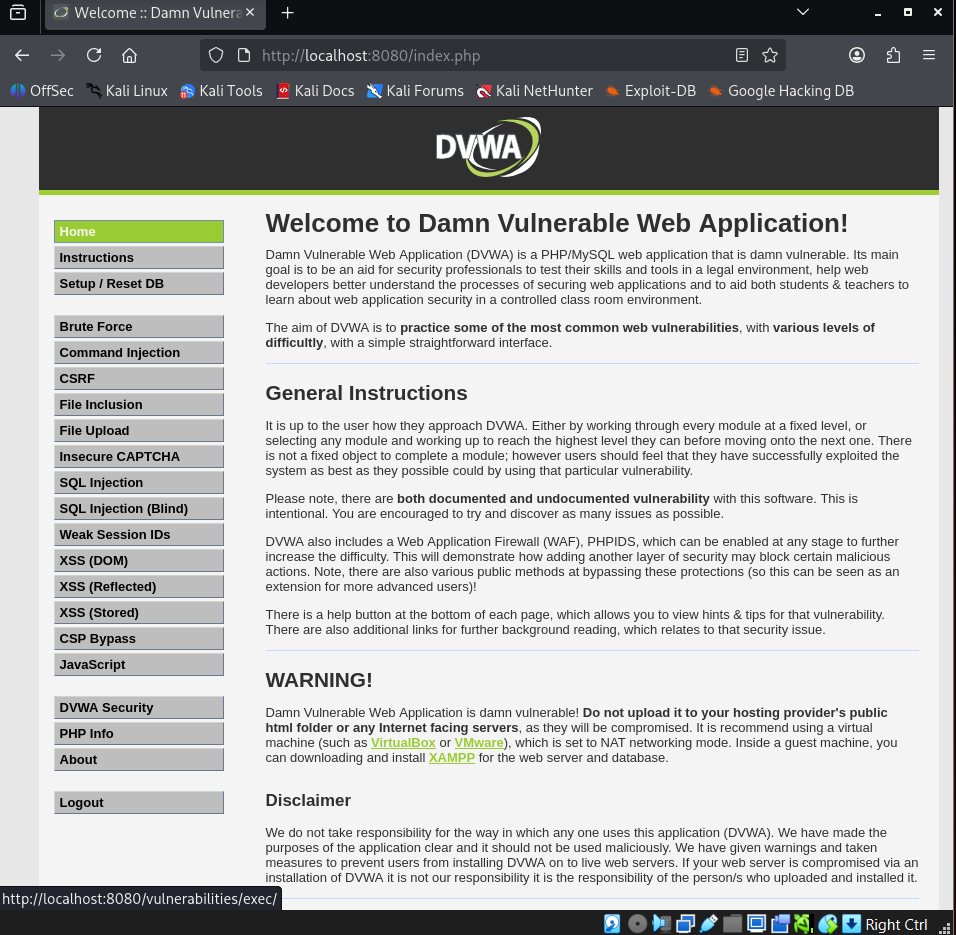
*DVWA успешно развёрнута и доступна на localhost:8080*

---

## Фаза 4: Подключение агента Wazuh

Агент Wazuh установлен на Kali, версия синхронизирована с версией manager'а (4.9.0), подключение подтверждено.

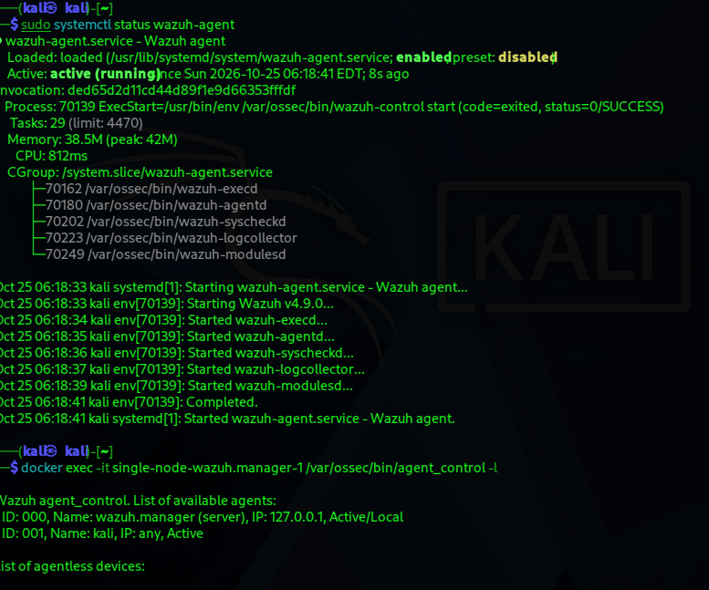
*Агент активен и подключён к менеджеру (agent_control -l)*

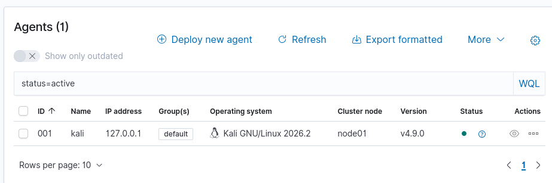
*Агент виден в веб-интерфейсе Wazuh как Active*

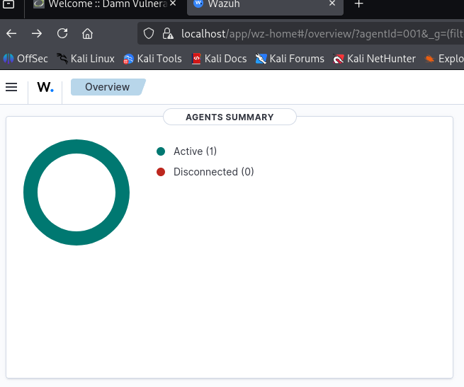
*Agents Summary: 1 активный агент*

---

## Фаза 5: Проверка полного пайплайна детектирования

Прежде чем переходить к атакам, был выполнен тест: действие на хосте → агент → менеджер → дашборд. Для этого был сгенерирован стандартный процесс повышения привилегий через `sudo`.

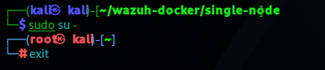
*Команда sudo su - / exit, генерирующая событие аутентификации*

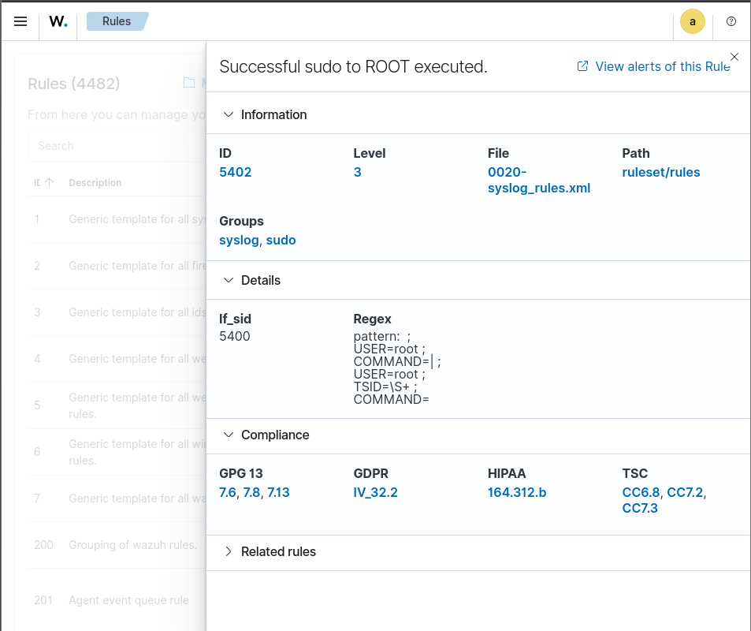
*Сработавшее правило Wazuh по умолчанию: "Successful sudo to ROOT executed" (MITRE T1548.003)*

Пайплайн подтверждён рабочим без каких-либо доработок — Wazuh обнаружил событие "из коробки".

---

## Фаза 6: Атаки на DVWA

### Атака 1 — SQL Injection

**Ручной тест** в модуле DVWA SQL Injection с payload `' OR '1'='1`:

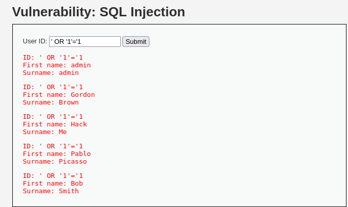
*Вместо одного пользователя запрос вернул всех пользователей базы данных*

**Автоматизированная атака через sqlmap** — обнаружены 4 техники инъекции (boolean-based, error-based, time-based, UNION), извлечены все таблицы, взломаны все 5 паролей через словарную атаку:

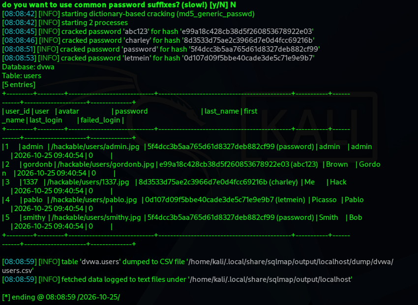
*sqlmap дампит таблицу users и взламывает хэши паролей*

**Обнаруженный пробел в видимости:** изначально Wazuh не фиксировал ничего — агент отслеживал только хост Kali, но не веб-трафик контейнера DVWA. Это было исправлено монтированием логов Apache из контейнера на хост и настройкой агента на их чтение (`<localfile>` в `ossec.conf`).

После исправления Wazuh **обнаружил атаку по умолчанию**, без написания кастомного правила — сработало встроенное правило 31164:

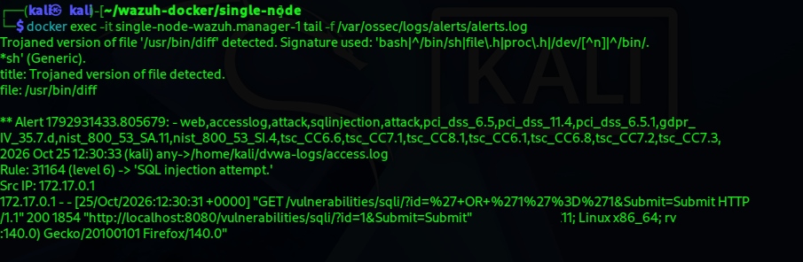
*Правило 31164 "SQL injection attempt" сработало на реальный payload*

**Вторая проблема:** алерт писался в alerts.log менеджера, но не доходил до индекса/дашборда. Причина — при смене пароля администратора Wazuh (через `hash.sh` + `internal_users.yml`) пароль Filebeat (компонент, пересылающий алерты в indexer) остался старым, захардкоженным в `docker-compose.yml` (`INDEXER_PASSWORD`). Из-за этого Filebeat получал ошибку 401 Unauthorized и молча терял данные.

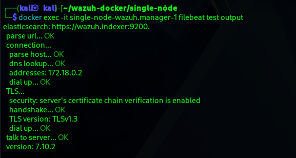
*После исправления пароля в docker-compose.yml и пересоздания контейнеров — соединение Filebeat с indexer восстановлено*

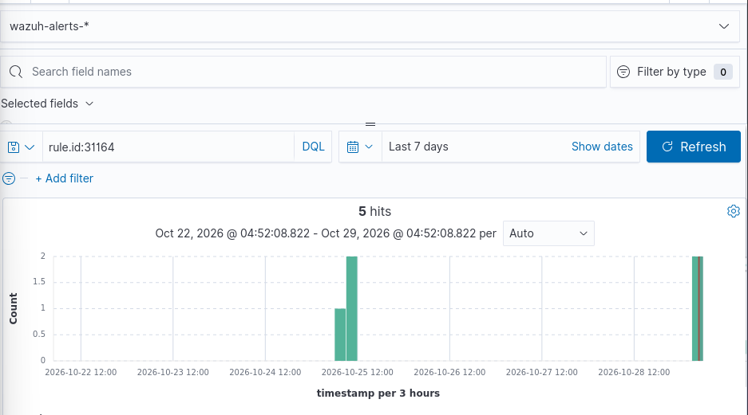
*Подтверждение через прямой запрос в Discover — все детекты SQL-инъекции полностью доходят до индекса*

---

### Атака 2 — Brute Force (подбор пароля)

Автоматизированный перебор паролей через **Hydra**.

Первая попытка (атака на форму `/vulnerabilities/brute/`, требующую сессионный cookie) содержала ошибку синтаксиса Hydra и не отправляла реальные данные:

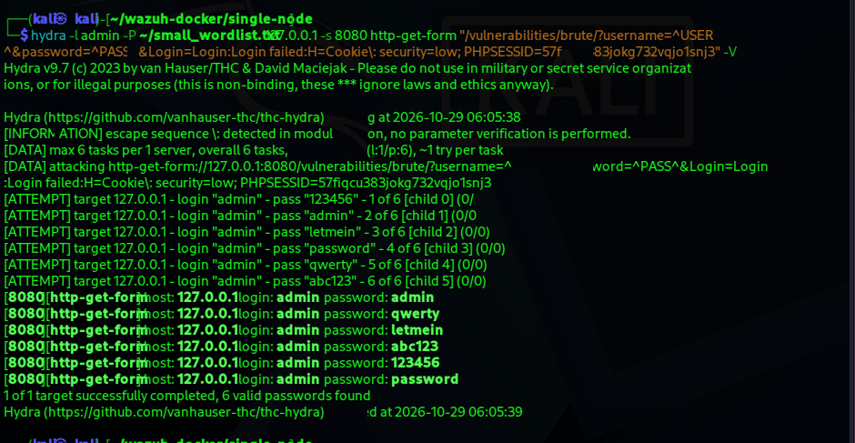
*Синтаксическая проблема с cookie-заголовком — плейсхолдеры не подставлялись*

Атака была перенаправлена на основную форму входа `/login.php` (POST, без необходимости в cookie) — и сработала корректно:

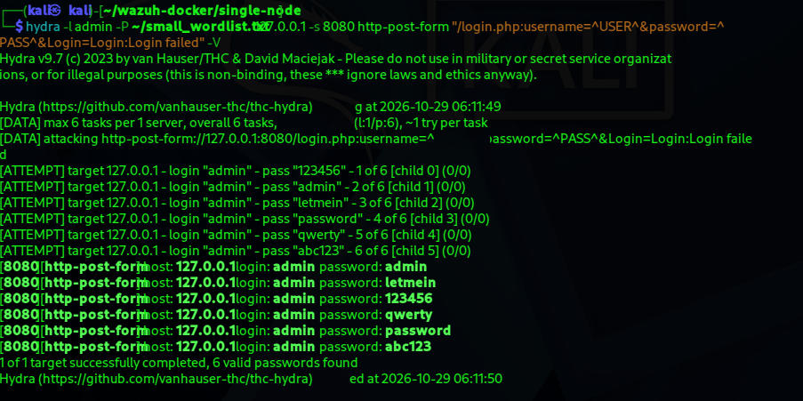
*6 быстрых попыток входа, пароль "password" подтверждён как верный*

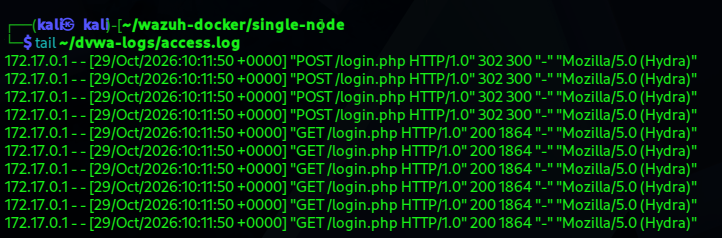
*Реальные POST/GET-запросы к /login.php, подтверждающие, что атака действительно дошла до сервера*

**Обнаруженный пробел:** встроенные правила Wazuh **не распознавали** повторяющиеся попытки входа как атаку — фиксировались только общие информационные записи ("PHP Notice"), без привязки к брутфорсу:

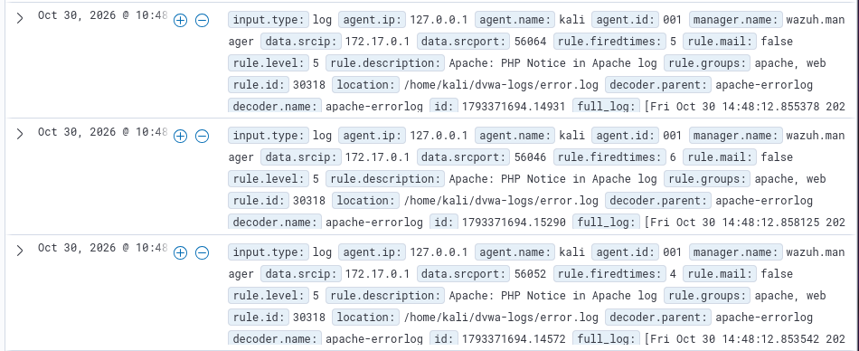
*Множественные попытки входа видны только как низкоуровневый шум, не как угроза*

---

### Атака 3 — Command Injection (удалённое выполнение команд)

В модуле DVWA Command Injection, payload `127.0.0.1; whoami`:

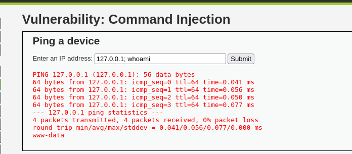
*Помимо результата ping, сервер вернул вывод команды whoami (www-data) — подтверждённое удалённое выполнение кода*

**Обнаруженный пробел:** у Wazuh **нет встроенной сигнатуры** для паттернов command injection в веб-запросах (`;`, `|`, `&&` в сочетании с shell-командами) — в отличие от SQL-инъекций, которые распознаются "из коробки". Атака не была зафиксирована вообще, даже в виде общего события.

---

## Фаза 7: Написание собственных (кастомных) правил детектирования

Все кастомные правила размещены в `/var/ossec/etc/rules/local_rules.xml` — отдельном файле, который не перезаписывается при обновлениях Wazuh. ID правил начинаются с 100000+, как того требует соглашение Wazuh.

### Правило 100002 — детектирование Command Injection

```xml
<group name="web,accesslog,attack,">
  <rule id="100002" level="10">
    <if_sid>31100</if_sid>
    <url>;whoami|;id|;cat%20|;ls%20|;pwd|;uname|%3Bwhoami|%3Bid|%3Bcat|%3Bls|%3Bpwd|%3Buname|\|whoami|\|id|&&whoami|&&id</url>
    <description>OS Command Injection attempt detected in web request.</description>
    <mitre>
      <id>T1059</id>
      <id>T1190</id>
    </mitre>
    <group>attack,command_injection,pci_dss_6.5,pci_dss_11.4,gdpr_IV_35.7.d,nist_800_53_SA.11,nist_800_53_SI.4,</group>
  </rule>
</group>
```

Правило построено как дочернее от базового правила `31100` (общий веб-трафик) — по той же модели, что и встроенные правила Wazuh для SQLi (31103) и XSS (31105). Уровень серьёзности **10** — выше, чем у SQL-инъекции (7), поскольку command injection даёт полный удалённый доступ к системе, а не только утечку данных.

**Важное открытие в процессе тестирования:** форма DVWA отправляет данные через POST, а стандартный формат логов Apache **не записывает тело POST-запроса** — только саму строку запроса без параметров. Это значит, что ни одно правило, каким бы правильным оно ни было, не могло бы обнаружить атаку, если данные вообще не попадают в лог. Для проверки правила использовался обходной путь: DVWA читает входные данные через PHP `$_REQUEST`, который принимает параметры как из GET, так и из POST — тот же payload был отправлен как GET-запрос (`curl ".../exec/?ip=127.0.0.1;whoami"`), что позволило зафиксировать атаку в логе и подтвердить срабатывание правила.

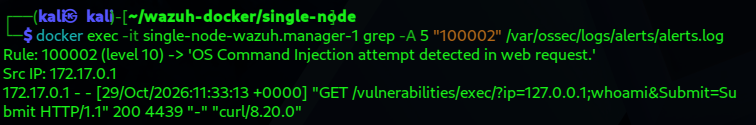
*Кастомное правило 100002 обнаруживает command injection*

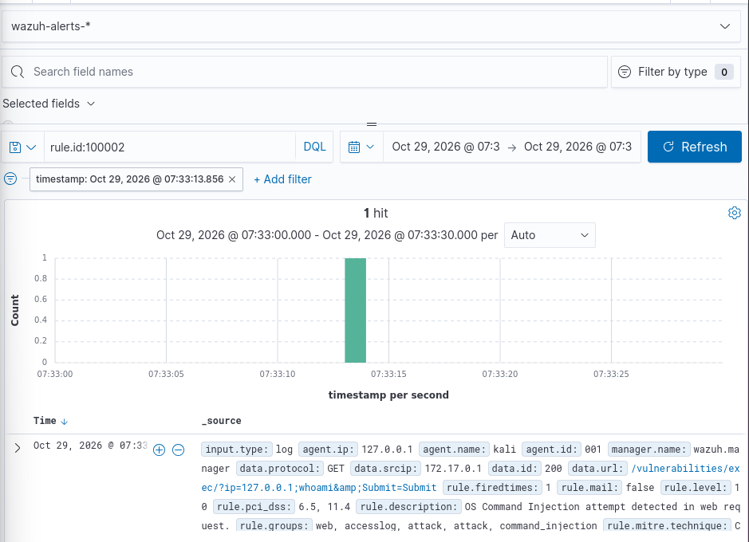
*Алерт полностью протегирован: MITRE T1059/T1190, PCI-DSS, NIST 800-53*

---

### Правила 100003 + 100004 — детектирование Brute Force (на основе частоты)

В отличие от command injection, брутфорс — это не единичный "плохой" запрос, а **паттерн поведения во времени**. Поэтому потребовались два связанных правила:

```xml
<rule id="100003" level="5">
  <if_sid>31108</if_sid>
  <url>/login.php</url>
  <description>DVWA login attempt (request to login.php).</description>
  <group>authentication_attempt,</group>
</rule>

<rule id="100004" level="12" frequency="5" timeframe="60">
  <if_matched_sid>100003</if_matched_sid>
  <description>Possible brute force attack: 5+ login attempts to DVWA login page within 60 seconds.</description>
  <mitre>
    <id>T1110</id>
  </mitre>
  <group>attack,brute_force,authentication_failures,pci_dss_10.2.4,pci_dss_10.2.5,pci_dss_11.4,gdpr_IV_35.7.d,nist_800_53_SA.11,nist_800_53_SI.4,</group>
</rule>
```

- **Правило 100003** (уровень 5, низкий) — просто помечает каждый запрос к `/login.php` как "это попытка входа". Само по себе — не повод для тревоги, одна попытка входа — это нормально.
- **Правило 100004** (уровень 12, высокий) — использует `frequency="5" timeframe="60"`: если правило 100003 срабатывает **5 и более раз за 60 секунд**, это уже не нормальное поведение, а вероятная атака перебором.

**Ключевая техническая проблема при отладке:** первая версия правила 100003 была построена как дочерняя от `31100`, но ничего не срабатывало. Диагностика через `wazuh-logtest` показала, что ответы DVWA на вход (коды 200/302) перехватывались более ранним встроенным правилом `31108` ("Ignored URLs — simple queries"), которое останавливает дальнейшую обработку лога — движок Wazuh прекращает проверку правил при первом совпадении. Решение: сделать правило 100003 дочерним именно от `31108`, а не от `31100`, чтобы оно срабатывало на уже "проигнорированном" трафике.

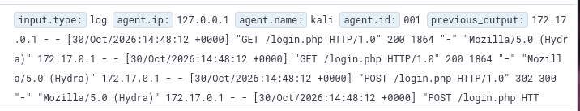
*Множественные POST/GET запросы к /login.php от Hydra*

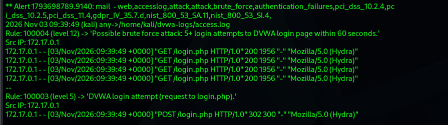
*Правило 100004 эскалирует после превышения порога — "Possible brute force attack"*

---

## Фаза 8: Сопоставление с MITRE ATT&CK

| Атака | Техника MITRE | Тактика | Детектирование |
|---|---|---|---|
| SQL Injection (ручная + sqlmap) | T1190 (Exploit Public-Facing Application) | Initial Access | Встроенное правило Wazuh 31164 |
| Brute Force (Hydra) | T1110 (Brute Force) | Credential Access | Кастомные правила 100003 + 100004 (на основе частоты) |
| Command Injection | T1059, T1190 (Command and Scripting Interpreter, Exploit Public-Facing Application) | Execution, Initial Access | Кастомное правило 100002 |

---

## Итоговая сводка по атакам

| Атака | Обнаружено изначально? | После исправлений |
|---|---|---|
| SQL Injection | ❌ Нет (отсутствовала видимость логов DVWA) | ✅ Да — встроенное правило 31164, после исправления видимости и пароля Filebeat |
| Brute Force | ⚠️ Частично (только общий шум, без привязки к атаке) | ✅ Да — кастомные правила 100003/100004 |
| Command Injection | ❌ Нет (нет сигнатуры для OS command injection) | ✅ Да — кастомное правило 100002 |

---

## Ключевой вывод проекта

SIEM-пайплайн состоит из нескольких независимых звеньев: источник лога → агент → менеджер → shipper (Filebeat) → indexer → UI. Смена учётных данных в одном компоненте (indexer) не распространяется автоматически на все остальные компоненты, которые аутентифицируются относительно него. Диагностика каждой проблемы требовала проверки каждого звена цепочки по отдельности (сырой лог-файл → alerts.log менеджера → собственный тест shipper'а → прямой API-запрос к indexer → UI), а не предположения, что весь пайплайн — единое целое.

Этот проект демонстрирует не просто установку инструментов, а полный цикл инженерии детектирования: от обнаружения пробела в видимости, через диагностику многокомпонентной системы, до написания, тестирования и валидации собственных правил детектирования — включая как простое сопоставление паттернов, так и детектирование на основе частоты событий.
